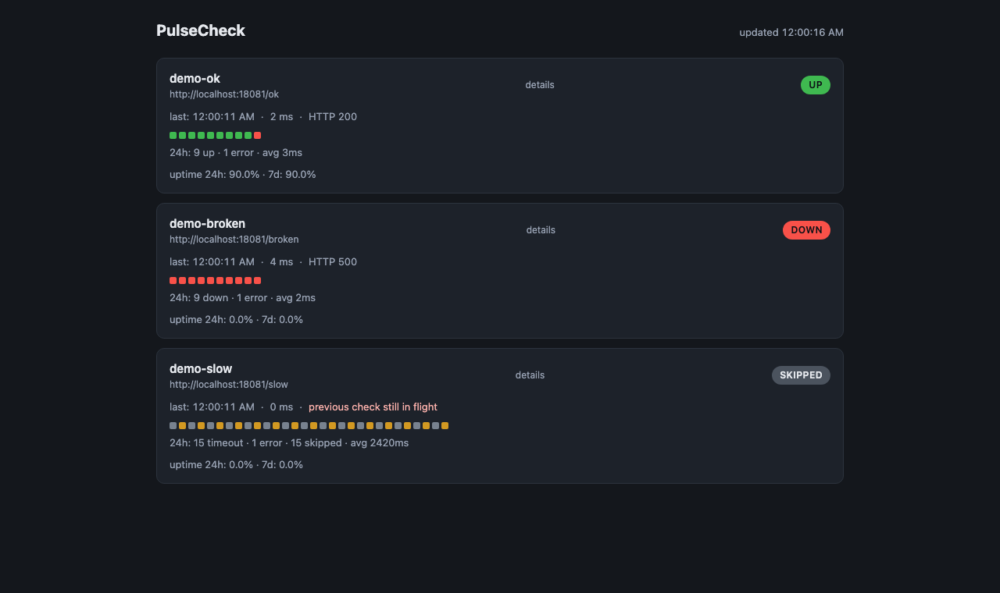

# PulseCheck

[](https://github.com/kemselcuk/pulsecheck/actions/workflows/ci.yml)

PulseCheck, bir JSON yapılandırmasındaki HTTP hedeflerini belirli aralıklarla kontrol eden, sonuçları yerel bir SQLite dosyasında saklayan ve küçük bir JSON API ile tek sayfalık bir durum paneli sunan tek bir Go uygulamasıdır. Sınırlı bir worker pool ile eşzamanlı kontrol yapar; geciken bir hedef diğerlerini bloklamaz, aynı hedefte çakışan bir tur `skipped` olarak kaydedilir ve `SIGINT`/`SIGTERM` sonrası süreç temiz kapanır.

Proje, Go'da **HTTP, eşzamanlılık ve hata yönetimini** gerçek ama küçük bir serviste göstermek için yazıldı: yalnızca standart kütüphane ve tek bir saf-Go SQLite sürücüsü; her anlamlı karar `docs/decisions.md`'de gerekçesiyle kayıtlı.

## Özellikler

- **Sınırlı worker pool:** eşzamanlı kontrol sayısı yapısal olarak `defaults.workers` ile sınırlıdır.
- **İstek başına context timeout:** her kontrol `context.WithTimeout` ile sınırlandırılır; tek bir timeout mekanizması vardır.
- **Çakışan kontrol `skipped`:** aynı hedefte önceki kontrol sürerken yeni tur atlanır ve nedeniyle birlikte kaydedilir.
- **24 saatlik saklama:** eski sonuçlar arka planda periyodik olarak temizlenir (yapılandırılabilir).
- **Tek sayfa panel:** gömülü HTML/CSS/JS; harici kaynak yok, çevrimdışı çalışır, 5 sn'de bir `/api/status` yoklar.
- **Graceful shutdown:** `SIGINT`/`SIGTERM` → checker durur, HTTP boşaltılır, veritabanı kapatılır; loglar sıralı adımları gösterir.

## Hızlı başlangıç

### 1) Yerel (tek komut, ikinci terminal gerekmez)

```console
$ make demo
```

`demo` hedefi iki binary'yi derler, `cmd/demo-targets` sunucusunu arka planda başlatır, `pulsecheck`'i ön planda çalıştırır ve çıkışta arka plan sürecini `trap` ile öldürür. Ardından tarayıcıda **http://localhost:8080** açın: üç hedef görünür —

- `demo-ok` → **up** (HTTP 200),
- `demo-broken` → **down** (HTTP 500),
- `demo-slow` → **timeout**/`skipped` (8 sn gecikmeli hedef, 5 sn timeout'u aşar).

Durdurmak için `Ctrl+C`.

Yalnızca servisi çalıştırmak için (varsayılan config `config.demo.json`, çalışma dizinine göreceli olduğundan **repo kökünden** çalıştırın):

```console
$ go run ./cmd/pulsecheck
# veya
$ make run
# başka bir yapılandırma ile:
$ go run ./cmd/pulsecheck -config yol/config.json
```

### 2) Docker Compose

```console
$ docker compose up --build
```

Aynı demo iki konteynerle ayağa kalkar: `demo-targets` (yalnız compose ağında, `:18081`) ve `pulsecheck` (`0.0.0.0:8080`). Panel yine **http://localhost:8080** adresindedir; hedefler `http://demo-targets:18081/...` adreslerine bakar.

## Yapılandırma

Yapılandırma JSON'dur ve `-config` bayrağıyla verilir (varsayılan `config.demo.json`). Alanların tamamı isteğe bağlıdır; verilmeyen her alan varsayılanına düşer ve her hedef `Load` sonrasında somut `interval`/`timeout` değerleri taşır. Süreler Go süre dizeleridir (`"10s"`, `"500ms"`, `"24h"`). Gerçekçi bir örnek: [`config.example.json`](config.example.json).

| Alan | Varsayılan | Açıklama |
|---|---|---|
| `server.addr` | `":8080"` | HTTP dinleme adresi |
| `storage.db_path` | `"pulsecheck.db"` | SQLite dosyası; eksik üst dizinler oluşturulur |
| `storage.retention` | `"24h"` | Bu süreden eski sonuçlar arka planda silinir |
| `defaults.interval` | `"30s"` | Varsayılan kontrol aralığı |
| `defaults.timeout` | `"5s"` | Varsayılan istek zaman aşımı |
| `defaults.workers` | `4` | Worker pool boyutu (> 0) |
| `targets[].name` | — (**zorunlu**) | Hedef adı; benzersiz olmalı |
| `targets[].url` | — (**zorunlu**) | Mutlak `http`/`https` URL |
| `targets[].interval` | `defaults.interval` | Bu hedefe özel aralık |
| `targets[].timeout` | `defaults.timeout` | Bu hedefe özel zaman aşımı |

Doğrulama katıdır: bilinmeyen alan, boş veya yinelenen hedef adı, mutlak olmayan URL ve pozitif olmayan süre/worker değerleri reddedilir. Deneyin:

```console
$ go run ./cmd/pulsecheck -config yok.json
time=... level=ERROR msg="failed to load config" path=yok.json err="config: open yok.json: no such file or directory"
$ echo $?
1
```

`config.docker.json`, `config.demo.json`'un birebir aynısıdır; tek fark hedef URL'lerinin compose servis adına (`http://demo-targets:18081/...`) işaret etmesidir.

## API

Salt okunur JSON API; yalnızca `net/http` (Go 1.22 pattern routing) kullanır, hiçbir şey yazmaz.

| Uç nokta | Açıklama |
|---|---|
| `GET /api/status` | Her hedef için son sonuç (`last`), son 30 sonucun özeti (`recent`) ve 24 saatlik sayaçlar (`stats`) |
| `GET /api/history/{name}?limit=N` | Tek hedefin en yeni sonuçları, yeniden eskiye; `limit` varsayılan 50, üst sınır 500; bilinmeyen ad → 404 |

Gerçek bir yerel koşumdan alınmış örnekler:

```console
$ curl -s http://localhost:8080/api/status
{"checked_at":"2026-10-18T14:58:19Z","targets":[{"name":"demo-ok","url":"http://localhost:18081/ok","last":{"outcome":"up","status_code":200,"duration_ms":1,"at":"2026-10-18T14:58:15Z","error":""},"recent":["up","up"],"stats":{"up":2,"down":0,"timeout":0,"error":0,"skipped":0,"avg_duration_ms":2}},{"name":"demo-broken","url":"http://localhost:18081/broken","last":{"outcome":"down","status_code":500,"duration_ms":1,"at":"2026-10-18T14:58:15Z","error":""},"recent":["down","down"],"stats":{"up":0,"down":2,"timeout":0,"error":0,"skipped":0,"avg_duration_ms":2}},{"name":"demo-slow","url":"http://localhost:18081/slow","last":{"outcome":"skipped","status_code":0,"duration_ms":0,"at":"2026-10-18T14:58:14Z","error":"previous check still in flight"},"recent":["skipped","timeout","skipped","timeout"],"stats":{"up":0,"down":0,"timeout":2,"error":0,"skipped":2,"avg_duration_ms":2501}}]}
```

```console
$ curl -s "http://localhost:8080/api/history/demo-slow?limit=3"
[{"outcome":"skipped","status_code":0,"duration_ms":0,"at":"2026-10-18T14:58:14Z","error":"previous check still in flight"},{"outcome":"timeout","status_code":0,"duration_ms":5001,"at":"2026-10-18T14:58:11Z","error":"Get \"http://localhost:18081/slow\": context deadline exceeded"},{"outcome":"skipped","status_code":0,"duration_ms":0,"at":"2026-10-18T14:58:08Z","error":"previous check still in flight"}]

$ curl -s -o /dev/null -w "%{http_code}\n" "http://localhost:8080/api/history/bilinmeyen"
404
```

## Başka projeye entegrasyon

PulseCheck paketleri `internal/` altındadır (dışa açık kütüphane değil), bu yüzden entegrasyon **HTTP API üzerinden** yapılır.

**(a) curl ile periyodik kontrol (cron örneği).** `/api/status` erişilemezse PulseCheck ölü demektir:

```sh
# crontab: her 5 dakikada bir erişilebilirliği doğrula
*/5 * * * * curl -fsS http://localhost:8080/api/status >/dev/null || echo "PulseCheck erisilemiyor" >> /var/log/pulsecheck-alarm.log
```

`jq` varsa yalnız düşük hedefleri süzmek de kolaydır:

```sh
curl -fsS http://localhost:8080/api/status \
  | jq -r '.targets[] | select(.last.outcome != "up") | "\(.name) -> \(.last.outcome)"'
```

**(b) Tarayıcı/JS içinde `fetch`:**

```js
fetch('/api/status')
  .then((res) => res.json())
  .then(({ targets }) =>
    targets.forEach((t) => console.log(t.name, t.last ? t.last.outcome : 'pending')));
```

**(c) Yanıt şeması (`/api/status`):**

```json
{
  "checked_at": "2026-10-18T14:58:19Z",
  "targets": [
    {
      "name": "demo-ok",
      "url": "http://localhost:18081/ok",
      "last": {
        "outcome": "up",
        "status_code": 200,
        "duration_ms": 1,
        "at": "2026-10-18T14:58:15Z",
        "error": ""
      },
      "recent": ["up", "up"],
      "stats": { "up": 2, "down": 0, "timeout": 0, "error": 0, "skipped": 0, "avg_duration_ms": 2 }
    }
  ]
}
```

`outcome` değerleri: `up`, `down`, `timeout`, `error`, `skipped`. `/api/history/{name}` aynı `outcome`/`status_code`/`duration_ms`/`at`/`error` alanlarını taşıyan bir dizi döndürür (`at` RFC3339 UTC).

## Mimari ve kararlar

### Paket haritası

| Paket | Sorumluluk |
|---|---|
| `cmd/pulsecheck` | Tüm parçaları birleştiren `main`; süreç yaşam döngüsü ve graceful shutdown |
| `cmd/demo-targets` | `net/http` ile yerel demo sunucusu: `/ok` → 200, `/broken` → 500, `/slow` → gecikmeli |
| `internal/config` | JSON yapılandırmayı okur, varsayılanları uygular ve doğrular |
| `internal/checker` | Tek HTTP kontrolü + sınırlı worker pool'lu zamanlayıcı |
| `internal/store` | SQLite kalıcılığı (kayıt, geçmiş, istatistik) ve periyodik temizlik |
| `internal/api` | Salt okunur JSON API (`/api/status`, `/api/history/{name}`) |
| `internal/web` | `embed.FS` ile gömülü tek sayfalık durum paneli |

### Neden bu kararlar?

- **Tek timeout mekanizması — context.** `checker.Check` hiçbir zaman `http.Client.Timeout` ayarlamaz; süre sınırı yalnızca istek başına `context.WithTimeout` ile verilir. Böylece "kontrol zaman aşımı" ile "shutdown iptali" aynı mekanizmadır: kapanışta in-flight kontroller anında iptal edilir ve çift deadline etkileşimi olmaz.
- **Hedef başına atomik in-flight kilidi.** Her tur `atomic.Bool.CompareAndSwap` ile sahiplenilir; önceki kontrol sürüyorsa tur bloklanmadan `skipped` + neden olarak kaydedilir. Kuyruk şişmez, geciken hedef kimseyi beklemez.
- **`Recorder` seam.** `checker` paketi `internal/store`'a bağlı değildir; sonuçları bir `Recorder` arayüzüne verir. `store` bu arayüzü uygular (derleme zamanı kanıtı: `var _ checker.Recorder = (*store.Store)(nil)`), testler ise `MemoryRecorder` kullanır. Bu, zamanlayıcıyı gerçek bir veritabanı olmadan test etmeyi mümkün kılar.
- **`modernc.org/sqlite` (saf Go).** CGO gerekmez: `CGO_ENABLED=0` ile statik derlenir, küçük bir Alpine imajı yeterlidir ve çapraz derleme sorunsuzdur. `mattn/go-sqlite3` CGO gerektirirdi.
- **Bağımlılık disiplini.** Uygulama kodu yalnızca standart kütüphane + tek bir saf-Go SQLite sürücüsü kullanır; config için YAML yerine `encoding/json` seçildi, böylece ek bağımlılık doğmadı.

Ayrıntılı karar günlüğü: [`docs/decisions.md`](docs/decisions.md) · Uygulama planı: [`docs/PLAN.md`](docs/PLAN.md).

## Testler

```console
$ make test        # go test -race ./...
$ make vet         # go vet ./...
```

Hangi test hangi vaadi kanıtlar:

| Vaat | Test |
|---|---|
| Eşzamanlılık ≤ `workers` | `TestSchedulerRespectsWorkerLimit` (sunucu tarafında eşzamanlı istek sayısını ölçer) |
| Geciken hedef diğerlerini bloklamaz | `TestSlowTargetDoesNotBlockOthers` |
| Çakışan tur `skipped` kaydı | `TestSkippedPersistedWhilePreviousInFlight`, `TestSchedulerSaturatedDispatch` |
| Graceful shutdown, goroutine sızıntısı yok | `TestSchedulerGracefulShutdown` |
| Tek kontrol sınıflandırması (up/down/timeout/error) | `TestCheckClassification` |
| Varsayılanlar/doğrulama + bundled config dosyaları | `TestParse`, `TestExampleConfigLoads`, `TestDemoConfigLoads`, `TestDockerConfigLoads` |
| Saklama/temizlik | `TestDeleteOlderThan`, `TestStartRetention` |
| API şeması/limit/404-405 | `TestStatusShape`, `TestHistory`, `TestMethodNotAllowed`, `TestUnknownPathIsNotFound` |
| Panel gömülü + harici kaynak yok | `TestIndexServed`, `TestNoExternalResources` |

Gerçek bir `go test -race -count=1 -v ./internal/checker/` koşumundan (yalnız ilgili satırlar):

```text
=== RUN   TestSchedulerRespectsWorkerLimit
    scheduler_test.go:118: workers=2 targets=6: max observed concurrent checks = 2
--- PASS: TestSchedulerRespectsWorkerLimit (2.00s)
=== RUN   TestSlowTargetDoesNotBlockOthers
    scheduler_test.go:220: fastA Up = 13, fastB Up = 13, slow in-flight skips = 10, slow timeout/down = 3
--- PASS: TestSlowTargetDoesNotBlockOthers (2.50s)
=== RUN   TestSchedulerGracefulShutdown
    scheduler_test.go:310: goroutines: baseline=3 after shutdown=3
--- PASS: TestSchedulerGracefulShutdown (0.56s)
=== RUN   TestSkippedPersistedWhilePreviousInFlight
    scheduler_test.go:380: Up = 2, in-flight skips = 18
--- PASS: TestSkippedPersistedWhilePreviousInFlight (2.00s)
=== RUN   TestSchedulerSaturatedDispatch
--- PASS: TestSchedulerSaturatedDispatch (0.21s)
ok  	pulsecheck/internal/checker	8.728s
```

## Docker

`Dockerfile` çok aşamalıdır: `golang:1.27-alpine` içinde `CGO_ENABLED=0` ile iki statik binary derlenir, `alpine` tabanlı son imaja kopyalanır (scratch yerine Alpine: `ca-certificates` ve bir kabuk sağlar, böylece `https://` hedefler ve hata ayıklama çalışır). İmaj root olmayan `pulsecheck` kullanıcısıyla çalışır; `ENTRYPOINT ["/pulsecheck"]`'dir. `compose.yaml` iki servis tanımlar (`demo-targets` + `pulsecheck`), ikisi de aynı imajı kullanır ve hangi binary'yi çalıştıracaklarını `entrypoint`/`command` ile seçer.

```console
$ docker compose up --build      # http://localhost:8080
$ docker compose down
```

`config.docker.json` konteyner içinde `/etc/pulsecheck/config.docker.json` yoluna kopyalanır ve `command: ["-config", "/etc/pulsecheck/config.docker.json"]` ile verilir.

## Demo videosu

72 saniyelik gerçek koşum kaydı — üç hedef yan yana:

[](assets/demo.mp4)

▶ **[Demo videosunu izle: assets/demo.mp4](assets/demo.mp4)** (72 sn, ~64 KB — panelde görünür: `demo-ok` kesintisiz `up`, `demo-broken` kesintisiz `down`, `demo-slow` ise `skipped`/`timeout` biriktirirken **diğer hedefleri hiç bloklamaz**; ayak şeridinde `skipped` nedeni "previous check still in flight" olarak görünür).

Video tamamen yerelde, tekrarlanabilir bir boru hattıyla üretildi (€0): `make demo` ile canlı stack + Chrome headless CLI ile 2 sn aralıklı 36 ekran görüntüsü + ffmpeg H.264 derlemesi. (Karar günlüğü: D28.)

## Lisans

MIT — telif hakkı Kemal Selçuk. Ayrıntılar için [`LICENSE`](LICENSE).
